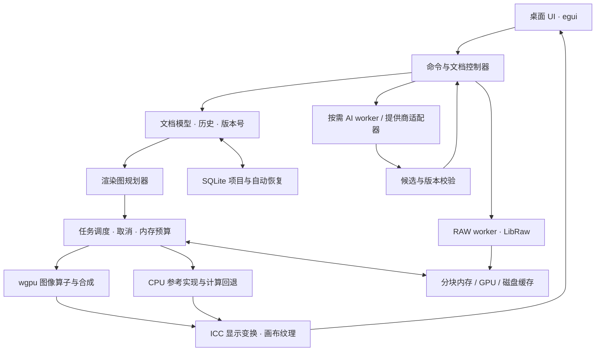

# 程序架构

## 分层与进程

编辑器采用模块化单体：一个桌面进程承担 UI、文档与预览，原生 RAW 解码在可重启工作进程中运行；AI 在独立、按需启动的 worker 中运行。跨进程只传命令与共享数据描述，不用 JSON/Base64 传整张图。



UI 只能提交命令、读取轻量 view model 与最终预览纹理；不直接改像素。图像算子不依赖 egui，存储不依赖 GPU，核心能在无窗口测试中运行。P0 可先在工作线程验证 LibRaw，v0.1 发布前完成进程隔离和内存峰值测试。

## 仓库模块规划

下面是待实现的 workspace 规划，当前没有生成空壳 crate。

```text
apps/desktop              窗口、工具、属性面板、输入适配
apps/raw-worker           LibRaw 隔离进程与输入限制
apps/ai-worker            按需加载模型 / ONNX 运行时
crates/document           文档、图层、参数、坐标与颜色类型
crates/commands           事务、撤销重做、编辑会话
crates/render-graph       节点、依赖、区域分析、缓存键
crates/engine-cpu         算子参考实现、RAW 显影基线
crates/engine-gpu         WGSL、纹理池、合成与显示
crates/jobs               优先级、取消、资源预算
crates/io                 JPEG/PNG/TIFF、元数据与原图哈希
crates/raw                RAW 读取契约与 worker 客户端
crates/color              工作空间、ICC、显示/导出变换
crates/storage            项目读写、块存储、迁移与恢复
crates/ai-contract        mask / 裁片 / 任务 / 提供商协议
native/libraw-shim        C ABI，不暴露 C++ 类布局
native/lcms-shim          ICC 与错误处理适配
shaders/                  与算子同版本的 WGSL
tests/fixtures            有再分发许可的照片、ICC、坏文件
tools/                    性能与像素质量验证工具
docs/                     设计与 ADR
```

不要为了每个小功能再造一套插件框架。首版使用内部 trait 和固定格式；稳定后再发布插件/worker 协议，避免 Rust ABI 和第三方动态库把核心绑死。

## 文档模型与命令

Document 保存画布尺寸、工作色域、源资产、图层顺序、节点参数、蒙版、几何映射、当前 revision 和格式版本。Layer 是用户看到的堆叠结构，RenderGraph 是由它派生的运算依赖图，两者不直接等同。

- SourceLayer：原始 JPEG/TIFF 或 RAW 资产与显影参数，原图不可变。
- RasterLayer：稀疏透明像素块，用于仿制、修复、减淡加深等；可保留笔画元数据，但把确认后的块存下来，避免算法升级导致旧项目变样。
- AdjustmentLayer：参数、蒙版与作用域。默认对下方组合结果运算；裁剪目标通过显式引用指定，禁止循环依赖。
- WarpNode：位移场、冻结蒙版、源坐标定义，用于液化。
- GeneratedLayer：生成裁片、合成蒙版、位置及提供商元数据；项目重新打开时无需再次运行模型。
- GroupLayer：v0.2 引入，先只支持隔离组；穿透组后续单独定义。

源 RAW 调整白平衡发生在源显影阶段，普通调整层的色温是对 RGB 的近似色彩调整，不能把两者混为同一算法。默认 UI 的“全图调整”路由到恰当阶段；高级模式显示区别。

所有修改通过 Command：AddLayer、ReorderLayer、SetParameters、PaintMask、ApplyPatch、SetWarp、AcceptGeneration。滑杆拖动中的中间值只形成临时预览；松开后提交一个历史项。一次笔画是一个事务。撤销存参数前值和受影响 tile 的旧内容引用，用写时复制而非复制整幅照片；历史块可落盘并受预算控制。

命令提交时 revision 递增，生成候选/渲染任务附带 revision。旧版本渲染结果不能覆盖新版本预览；AI 候选可保留供用户比较，接受前再次检查版本与几何映射。Undo/redo 也产生新的单调 revision，避免旧任务复活。

## 图像与颜色契约

建议内部工作空间为线性 Rec.2020，首版输出 SDR；最终在 P0 用肤色和宽色域照片确认。GPU tile 用 RGBA16F，累加及敏感步骤使用 float32；CPU 参考用 float32。中间值允许负值与大于 1，不能过早裁剪高光。透明合成使用预乘 alpha，ICC/LUT 处理前解预乘，alpha 为 0 的颜色约定为 0。

每个算子声明输入/输出色彩域：曝光、合成在线性域；曲线、HSL 等在已声明的感知域运算，再变换回工作域。不能直接对线性 RGB 套一组 sRGB 滑杆公式。超色域与负值处理、RAW 高光压缩和最终输出映射需要固定策略与版本号。

```text
RAW 读取 mosaic + 黑/白电平 + CFA + 白平衡 + 相机信息
  → 黑电平/坏点校正 → 白平衡/源曝光与高光处理
  → 去马赛克 → 相机 RGB 到工作空间 → 源图层
普通 RGB 输入 → 方向修正 → ICC/传递函数解码 → 源图层
源图层 → 调整/修饰/蒙版/位移 → 多层线性合成
  ├→ SDR 显示映射 → 显示器 ICC 变换 → 显示编码 → 预览
  └→ 固定 revision 的全尺寸计算 → 输出色彩变换 → 编码与 ICC/元数据
```

LibRaw 负责读取，不把它的默认 JPEG 风格渲染当作专业显影。P0 从 Bayer 样本开始，双线性去马赛克仅用于工程验证；v0.1 要通过更高质量边缘处理与真实照片验收。X-Trans、特殊压缩、镜头校正和完整 DCP 色彩路线分别设里程碑；必要时评估 LibRaw 内置处理作为限定格式的兼容路径，但不可重复应用白平衡/曝光/伽马。

初始相机矩阵不足时明确标为兼容显影。皮肤色、白平衡和高光恢复失败时不能只用“成功解码”判定 RAW 支持。输出不直接截取屏幕纹理，显示器 ICC 变换不能进入导出照片。

显示 GPU 路径：由 Little CMS 生成工作到显示的 LUT/曲线组合，随显示器或 ICC 更新失效；先与 CPU 变换核对插值误差和肤色，再决定 LUT 分辨率。避免交换链 sRGB 编码和 shader 编码重复执行。Windows HDR 桌面下的 SDR 呈现要实测，首版不承诺 HDR 编辑。

## 分块、预览与调度

初始候选 tile 为 512×512；RGBA16F 单块 2 MiB。256×256 与 512×512 在 P0 比较，最终全流程统一。蒙版通常 R16，位移场 RG32F 或经误差验证的 RG16F。tile 大小与 halo 开销都计入预算。

缓存键包括源资产哈希、节点版本、参数/蒙版版本、颜色契约版本、tile 坐标、mip、质量档；必要时加入执行后端/精度档。缓存命中必须数学语义一致，不能只看“同一个文件名”。

拖动时优先当前视口、较低 mip 和近似质量；交互停止后补算高质量。降噪、锐化等必须按实际 mip 定义半径和强度，近似预览标记清楚。液化/仿制可能访问远处来源，不能只按输出 tile 请求输入。

局部算子声明 support/halo；多级算子的依赖范围累积。带 halo 计算后裁去边缘。降噪、修复和 Poisson 融合有不同依赖范围，后者不能简单独立分块，否则产生接缝。修复使用含上下文的局部 ROI；大范围操作降级/限额/全局任务。直方图与统计量先做缩略统计，再异步更新高质量结果。

线程/任务职责：UI 主线程仅交互和展示；GPU 提交集中管理；CPU 池做计算；I/O 线程负责块读取、项目提交；RAW 与 AI 进程独立。任务优先级为交互预览 > 可见区域精算 > 用户等待的选区 > 导出 > 缓存预热；导出有独立配额，避免被连续交互饿死。

新滑杆输入合并同类任务并取消旧 revision。窗口空闲时停止连续请求重绘；不能让 immediate-mode UI 无意义常驻 60 FPS。后台进度节流，笔刷活动与画布改变才高频刷新。

MemoryBudget 统一核算 RAM/GPU/磁盘缓存与 worker 峰值。先淘汰可重建块，再降低预览分辨率、串行重任务、暂停预热；必要时落盘。RAW 全图读取可能有整幅暂存峰值，因此初始只并行解码一张，大于容量时提前提示。关闭文档释放源数据和 GPU 引用；关闭 AI 工具允许卸载模型进程。

24,000,000 像素 RGBA16F 约 183 MiB，RGBA32F 约 366 MiB。十个满幅像素层的原始内容就可能接近 1.8 GiB，尚未算历史和中间结果。分块不会减少必要数据的总量，作用是控制驻留、复用与增量计算；稀疏修饰层和参数调整层才会真正避免大量复制。

## 持久化与恢复

建议 `.lumina` 为版本化 SQLite 文件：metadata、assets、asset_chunks、layers、nodes、masks、blobs、snapshots、journal。块内容按哈希去重、无损压缩；源 RAW/JPEG 的字节分块存储，不能用重新编码的 RGB 替代原图。

默认内嵌原图形成可携带项目；可选外部引用时保存内容哈希和路径，移动项目后提供重新定位，不只凭文件名判断。缓存目录独立，不把可重建 mip 当永久历史。预设使用版本化 JSON，记录参数而不是设备相关 LUT 缓存。

工作期间允许 WAL 和恢复侧文件，但不能让用户只复制主数据库后丢失最近内容。显式保存/另存为用 SQLite backup 生成一致的临时目标、关闭句柄并刷新后原子替换；成功后目标是一份可独立读取的快照。自动恢复写入独立 recovery 文件，保留上次成功保存的项目，用户退出时明确处理未保存修改。

每次提交以完整事务关联块引用与图结构；磁盘满时保留上次提交，不误报保存成功。未知节点保留其原始数据并报告兼容问题，不能静默删除。打开文件限制尺寸、块数量、解压大小和依赖图深度，检查循环及哈希；针对损坏与半写文件做恢复测试。

## AI 协议

SegmentRequest：job_id、document_revision、目标节点、图像块/裁片句柄、坐标变换、点/框与增减语义、已有 mask、模型版本、资源限制。

SegmentResult：同一 job_id/revision、mask 数据与其分辨率/坐标空间、模型版本、质量提示。embedding 缓存绑定实际输入内容和预处理版本；照片/目标节点变化就失效。缓存一次编码，多次点选解码。最终高分辨率细化需要独立算法，不是双线性放大就完成。

InpaintRequest：源 revision、上下文 RGB 裁片、生成 mask、最终允许修改 mask、原始 ROI 与缩放映射、提示词、模型/提供商版本、随机种子（若支持）、颜色契约、取消令牌。

InpaintResult：候选图像、其坐标/颜色定义、来源元数据、任务状态。外部图像先验证尺寸和色彩再合成；保留选区外字节/像素不变的验证基线。接受时创建 GeneratedLayer，与候选文件、融合 mask 和位置一起持久化；密钥不写进项目。

IPC 使用版本化长度前缀消息 + 共享内存/临时块句柄；明确所有权、最大消息/图像大小、超时和崩溃清理。HTTP 本地服务的 token 进入凭据管理；仅在实际生成时向已配置地址发送裁片。取消不一定能中止第三方计算，客户端仍必须立即停止等待和阻止结果自动提交。
