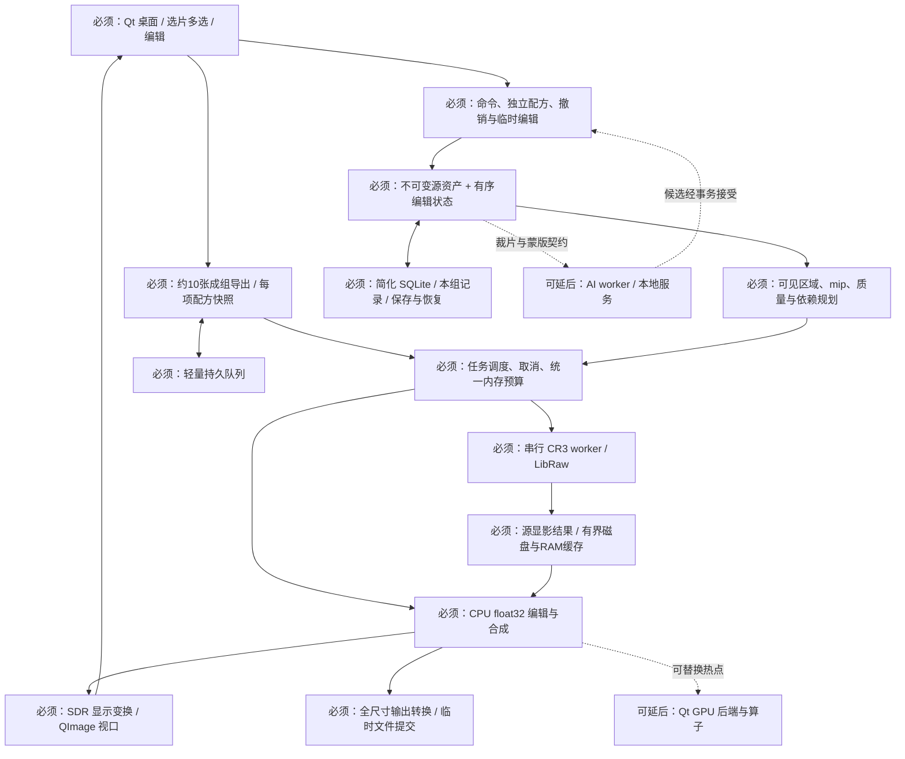

**Lumina（琉明）独立审查与方案决策 · 2026-10-12**

**结论：按你补充的条件，推荐 C++20 + Qt 6 Widgets，同语言图像核心；先做佳能单图人像精修与基础批量，撤销 Rust + egui + wgpu 的默认地位。** RAW 优先复用，AI 完全退出首版主线。轻量化依靠有限范围、代理预览、单张在途和有界缓存，不能靠语言名称保证。

本报告依据：先读 ASTRA-REVIEW.md、DECISIONS.md，再读六份设计文档、原型源码、截图、qa/report.json 与检查脚本。ZIP SHA256 为 `37ee12ac7b9222c78e968484f62d9668a4589ac27ccb4d01f4930a8dc3b99176`，与附带校验值一致；ZIP 内 26 个条目对应的本地副本无内容差异。附件中的建议和审查提示作为待审资料，未当成你已批准的实现指令。未改原交接包，未运行生产图像引擎、模型或性能测试。

已确认的决策输入（按本日后续补充修订）：你单人开发，C++/Qt 经验多于 Rust，正常工作日投入、不急于出成果；目标 8–16 GB 入门核显笔记本；主要输入 JPEG 与佳能 CR3；输入像素上限 45MP。个人照片先选片再逐张精修；接单通常约 10 张，先统一参数基调再逐张手动调整。精修允许低分辨率预览，导出后再查看完整质量；机型/镜头/固件专属优化、机内风格匹配可先分离。首版不需要 PSD。约 10 张是典型修图/交付量，不是文件夹只能有 10 张或产品的张数硬上限；选片前的素材可能更多。

文中“证据”指附件可观察内容或官方资料；“建议”是本次工程判断；所有性能/色差/质量门槛均为**待测验收目标**；人周与月份均为**估算**。网页核验日统一为 2026-10-12；能固定版本/日期的来源已明确标注。

**一、产品定位与首版边界**

推荐定位：**离线、无需账号的轻量人像摄影编辑器，让核显笔记本完成一组照片的基础统一调色、重点照片的自然局部修饰，以及可靠导出。** “PS 常用能力”保留为长期方向，不作为 v0.1 功能清单。你不急于发布，适合把色彩、保存和交互打牢；这不构成同时建设完整 RAW、通用合成和 AI 引擎的理由。

当前方案的主要弱点有实质冲突：产品验收要求去瑕疵和局部背景调整，功能表却把相应工具推迟；完整多层结构被提前设为必要条件，裁剪/校直反而未清楚进入功能表；P0 将 AI 完整部署列为必过门槛；第二版 UI 用大量长期功能营造专业感，但你的批量任务没有真正入口。应围绕任务重排，而不是照着所有控件开工。

| v0.1 必须交付 | 明确限制 |
|---|---|
| 文件夹/多文件打开、选片、真实照片胶片条、多选与成组导出 | 最小选片标记为未标记/保留/排除，排除不删源文件；可筛选保留照片；当前只驻留一个编辑文档，缩略图按需加载；不做照片库/DAM、人脸检索、云同步 |
| JPEG 与 CR3 为首版主要输入，常规 RGB PNG/TIFF 为辅助输入；像素上限 45MP | 按解码有效图像宽×高≤45,000,000 验证，不能用压缩文件大小判断；超限清楚拒绝且不静默缩小原图。TIFF 先限 RGB 8/16-bit、已测试压缩；CR3 基础兼容验收与专属优化分开 |
| 非破坏裁剪、旋转/校直、曝光、白平衡、基础色调与饱和度 | 保留高光/阴影压缩但不把降低亮度称为找回饱和细节；首版不做 HSL、多通道曲线、LUT 商店 |
| 手动局部调整 | 软画笔增/减、反选、羽化、显隐，局部曝光/饱和度；至少支持多个命名局部调整；不要求 AI 才能选背景 |
| 手动选源的仿制去瑕疵 | 一个稀疏修饰层，大小/硬度/不透明度，源点与落点预览；首版不承诺自动找源、内容感知修复、磨皮/瘦脸。产品上叫“仿制”，不伪称自动修复 |
| 约 10 张的参数复制、逐张独立精修、后台成组导出 | 复制当前照片选定参数的值，各图之后独立；不跨照片复制修饰笔触、局部蒙版、裁剪；一张 RAW 在途；保留取消/失败重试，复杂队列优先级/并行调度延后 |
| 单图项目与本组工作记录、自动恢复、撤销/重做、原图比较、导出后完整质量检查 | 低分辨率编辑预览不作为导出源；多个局部节点有真实顺序和作用域；不强制首版具备全分辨率实时精修；不提供通用合成工作区 |
| JPEG+sRGB、16-bit TIFF 导出 | TIFF 先提供 sRGB/Adobe RGB 等已验证 RGB 输出；正确嵌入 ICC；质量/尺寸/元数据策略明确；PNG 导出可延后 |

完整任务分为两个入口，共用一个编辑器：

- **个人照片：**打开素材 → 标记保留/排除、筛选 → 单张精修 → 保存 → 导出 → 查看成片完整质量。
- **约 10 张接单：**选一张定基调 → 选择要复制的全局参数与目标照片 → 逐张独立调整曝光/颜色/局部/修饰 → 标记“已检查” → 导出本组 → 检查完整质量并返回对应文档修订。

首版参数同步采用一次性复制，而非持续联动的母版。面板显示当前照片、同步来源、勾选参数与目标数量；首版只做“复制参数值”，不同时引入相对增量同步。曝光和白平衡可显式勾选，默认不把它们视为所有照片必然相同；JPEG 与 CR3 只复制语义兼容的参数，RAW 相机白平衡不能直接当作 JPEG 同义参数。复制后各图拥有自己的完整参数快照，修改基准照片或预设不会悄悄改变其他已精修照片。

再次同步时只作用于明确选择的照片与参数，并说明这些值将被替换；基调同步后已有手动修改或已标记“已检查”的照片默认排除，用户可以主动纳入。记录上次同步之后是否有单图修改即可，不引入参数继承链。新编辑/再次同步使相应“已检查”状态失效。整次同步是一条组级可撤销操作，保留各图前值；先撤销该次同步之后的单图编辑再回退组操作，不能让两个历史栈互相覆盖。首版不做“保留所有单图偏移并重新套母版”的复杂继承模型。选片保留/排除与本次导出选中集合分开，排除标记不删除原片。自动美肤仍是后续独立能力，不是这两个已确认流程的前置依赖。

延后：独立传统降噪面板、高级锐化、自动修复/Poisson、液化、AI 分割/降噪/生成、虚拟副本、通用图层合成、PSD、HDR 编辑、镜头资料库与多平台发布。RAW 基线中已有的固定降噪/锐化参数要记录并验收，但不因此声称拥有独立高质量降噪产品能力。高 ISO 观感差的样本不能从测试集中消失；若它们是主要用户任务，就应调整首版范围，而不是降低质量口径。

**二、技术栈决定：采纳、调整、拒绝**

| 候选项 | 决定 | 理由与明确边界 |
|---|---|---|
| Rust 核心 | 拒绝作为首版默认 | 当前没有既有 Rust 引擎资产，你的 C++ 经验更有价值。核心与 UI 分离用模块边界实现，不必引入双语言 ABI/构建/调试成本。以后有成熟 Rust 模块再单独引入 |
| Qt 6 Widgets + C++20 | 采纳 | 更适合现有经验和工具密集桌面；菜单、输入、数值、列表与辅助技术入口成熟。使用 CMake、锁定原生依赖和编译选项；核心不依赖 QWidget |
| egui/eframe + wgpu | 拒绝作为默认，保留条件备选 | 能实现第二版外观和普通交互；专业输入、自绘控件与颜色呈现仍需集成。你的学习成本没有对应的已知性能收益 |
| Qt Quick/QML、Widgets 中混用 QQuickWidget | 延后 | 漂亮外观不要求引入另一套 UI 技术；避免额外场景图与混合呈现成本。Widgets 可通过统一样式和少量自绘控件达到本稿视觉 |
| CPU 图像管线 + QImage/QWidget 视口 | 采纳为第一条可交付路径 | float32 计算，可见区域/代理图显示，后台全分辨率导出。QImage 是帧容器，QPainter 不承担 RAW/摄影算法定义 |
| 全面 GPU 化、Qt + wgpu 双渲染栈 | 拒绝首版前置要求 | 先测热点；若 CPU 代理交互不达标，加入单一 Qt 画布后端及有限 GPU 算子。避免跨设备共享纹理、回读和同步复杂度 |
| QRhiWidget / QRhi | 调整为有门槛的加速选项 | 优先 Windows D3D11 候选；必须测试实际核显。QRhi 有有限兼容保证、额外离屏合成，需封装并锁 Qt 版本；不让它渗透文档与存储 |
| LibRaw + 现有显影 | 采纳，但限制机型/模式和输出语义 | 复用解码与现有 AHD/DCB 等处理做基线；不从双线性开始研发完整专业显影；质量不通过就收窄承诺或换复用路线 |
| Little CMS 2 | 采纳 | 单一 ICC 转换负责人；Qt 颜色标签不替代输入/显示/导出契约 |
| 线性 Rec.2020 / 全部 RGBA16F | 调整 | 一个固定内部线性 Rec.2020 D65 工作基底；CPU/母版计算 float32。half 仅用于通过误差验收的可重建预览缓存，不作为所有永久数据默认 |
| 512 tile / 多模块渲染图 | 调整 | 默认先 256 逻辑 tile，与 512 做实测；外部 RAW 可全图、算子可 ROI。用有序编辑管线与少数依赖节点，不建通用节点编辑器 |
| SQLite 项目 | 采纳并大幅简化 | C/C++ sqlite3 接口；版本化 recipe、资产与 blob；单写入队列。取消首版持久化无限历史、通用块去重与复杂 journal/snapshot 层 |
| RAW/AI 独立进程 | 调整 | RAW 发布前一个可重启串行 worker，限制峰值并隔离坏文件；AI 后续按需独立 worker。CPU 编辑/存储不额外拆进程 |
| AI 首版 P0 门槛 | 拒绝 | 模型缺失、推理失败不能影响编辑/保存/批量。只保留普通蒙版、裁片、事务数据边界 |
| Windows 11 x64 | 暂采为测试/首发基线 | 与你的目标合理相容，但不是已获得用户确认的最低系统；若必须 Windows 10，应在 P0 前加入真实机器，而非以后再发现依赖限制 |
| Apache-2.0 | 暂采用于自有源码 | 允许闭源衍生；不覆盖 Qt、LibRaw、模型和样片。若你要求衍生持续开放，或选入 GPL 算法库，则重审 GPL-3.0 路线 |

Qt 6.12.0 已于 2026-09-30 发布，可作现在的 P0 版本候选；本次也核对了公开可下载的 Qt 6.11.2（2026-08-18）资料。正式编码时锁一套公开可取得的稳定版本，不把商业 LTS 的完整维护待遇当成开源用户天然拥有的承诺。[Qt 6.12 发布](https://www.qt.io/blog/qt-6.12-released)、[Qt 6.11.2 发布与下载说明](https://www.qt.io/blog/qt-6.11.2-released)

**Rust + egui + wgpu 的能力判断与切换条件。** 核对 egui/eframe 0.36.2、winit 0.30.13 及该工作区的 wgpu 30.0：中文 IME、AccessKit、按需重绘与自定义 GPU 回调均有入口。Windows winit 确实有 pen pressure 路径，不能说“完全不支持压感”；但 egui 通用事件不是完整的倾斜/橡皮擦端/接近离开事件契约。笔刷还需要逐样本采集、插值、捕获、失焦结束和鼠标事件去重。[egui 0.36.2 依赖](https://raw.githubusercontent.com/emilk/egui/0.36.2/Cargo.toml)、[Event](https://docs.rs/egui/0.36.2/egui/enum.Event.html)、[winit Windows 后端](https://raw.githubusercontent.com/rust-windowing/winit/v0.30.13/src/platform_impl/windows/event_loop.rs)、[自定义 GPU 回调](https://docs.rs/egui-wgpu/0.36.2/egui_wgpu/trait.CallbackTrait.html)

因此无需再做一个与 Qt 并行的完整 egui 原型。只有维护者结构变成 Rust 为主，或出现可复用的成熟 Rust 核心，并且同一纵向样机证明净收益时，才重开选型。Qt 上 CPU 视口慢时先改缓存/分辨率/算子或 CanvasBackend，不换 GUI；QRhi 在目标驱动上不稳定则保留 QImage 路径。若某条路线不能通过中文输入、键盘焦点、真实 100% 落点、颜色与撤销门槛，禁止仅因包体小就采用。

Qt 的 QTabletEvent 提供 pressure/tilt/rotation，但驱动仍需实测；QImage 的 setColorSpace 是标记而非像素转换。QRhiWidget 自 Qt 6.7 提供，Windows 默认 D3D11，支持浮点缓冲；QRhi/QShader 无跨 minor 的稳定源/二进制兼容承诺，使用它意味着接受版本绑定。[QTabletEvent](https://doc.qt.io/qt-6/qtabletevent.html)、[QImage](https://doc.qt.io/qt-6/qimage.html)、[QRhiWidget](https://doc.qt.io/qt-6/qrhiwidget.html)

**三、RAW：复用边界、相机白名单与质量验收**

默认采用 LibRaw 0.22.2（2026-07-16）现有解码/显影路径做 P0 基线。官方定位偏 RAW 读取，附带 dcraw 处理；它既不是仅解码，也不是现成完整专业摄影引擎。0.22.2 的处理源码存在向 ushort 写回的 CLIP：设置 16-bit 和 gamma=1，不能证明整个处理链保留负值、超白与全部传感器动态范围。[LibRaw 发布](https://github.com/LibRaw/LibRaw/releases/tag/0.22.2)、[定位](https://www.libraw.org/about)、[实际处理源码](https://raw.githubusercontent.com/LibRaw/LibRaw/0.22.2/src/postprocessing/postprocessing_utils.cpp)

执行策略：原始 CR3 字节永久保留；固定自动增亮、白平衡、相机矩阵、去马赛克、高光、缩放和输出色域的策略。16-bit 线性已显影 RGB 转 float32 编辑，明确它是已有截断边界的渲染结果。RAW 曝光/WB 改动回到原始数据重显影；交互期间可有带标识的近似反馈，停止后以真实结果替换。不要把对已剪切 RGB 降亮称为 RAW 高光恢复。不要把库参数范围外的滑杆悄悄换为不同算法却仍标同一物理含义。[LibRaw 参数](https://www.libraw.org/docs/API-datastruct.html)

首版值得自行实现的是：可复现的基本曝光/色调公式、参数语义、蒙版刷画、仿制采样、裁剪、配方同步、调度与缓存、验证工具。首版不值得研发的是：新的高质量去马赛克、高光重建、完整相机颜色/DCP、神经降噪、镜头数据库。复现已发表公式与原创算法研究是两类投入。

机型/镜头/固件专属优化从当前设计决策中分离，不要求你现在列出所有型号；镜头校正、机内风格匹配不是首版前置项。**基础 CR3 解码、白平衡、颜色与方向正确性仍必须验收。** 已渲染 JPEG 中实际应用过的机内处理已进入像素；CR3 仍需显影，其内嵌预览也不能代表最终 RAW 处理结果。Canon 文档明确区分 RAW 传感器数据与由它生成的 JPEG/HEIF，不能把“成片已经处理过”扩展为 CR3 无需处理。[Canon 图像质量说明，核验 2026-10-12](https://cam.start.canon/en/C012/manual/html/UG-04_Shooting-1_0030.html)

实施时用代表性实拍 CR3 建立已测试兼容列表，机型/固件/模式仅作为回归样本元数据，不为每个固件研发优化算法。覆盖常规 RAW、C-RAW 及接近 45MP 的样本；特殊 Dual Pixel RAW、RAW burst 语义首版可拒绝编辑或仅预览。对未测组合诚实标明状态，不宣称所有 .CR3 扩展名都兼容。原先 R6 Mark II 24MP 只能作为一种测试样本，不足以证明新确定的 45MP 上限。[Canon Dual Pixel RAW](https://cam.start.canon/en/C012/manual/html/UG-04_Shooting-1_0040.html)、[LibRaw 机型列表](https://www.libraw.org/supported-cameras)

最小样本建议 40–60 张：日光/钨丝/闪光/混合光，多种肤色，灰卡/色卡、白衣/逆光窗、LED 饱和色、头发/睫毛/织物/斜线、高 ISO 阴影、竖幅方向、相同场景 RAW/C-RAW。对照固定版本 Canon DPP 和 RawTherapee 5.13（2026-07-26），记录其自动增强、降噪、锐化和相机风格；默认风格不同不等于 Lumina 错误。绝对色准只能用受控色卡/照明评估，不能用一张生成样片或与 DPP 默认输出的像素差证明。[RawTherapee 官方版本](https://rawtherapee.com/)

建议质量门槛：全部已测试组合几何/方向正确；无系统性肤色偏绿/偏洋红，无明显拉链纹/伪色和高光彩边；用户及另一位有摄影经验者分别在适屏和导出后 100% 检查并记录失败图。受控色卡的中性渲染初始目标为 ΔE00 中位数≤3、p95≤6，须先固定曝光归一、光源与参考数据。通道完全饱和不承诺恢复真实细节。高 ISO 样本不合格时明示质量范围。首版允许 RAW 输出与机内镜头校正/风格不同，记录差异，不擅自把专属校正重新加回首版。

失败替代顺序：先调现有路径/缩小模式清单；仍失败则用 DPP 等导出 16-bit TIFF 交接，明确这是 RGB/TIFF 版本，**不算原定 CR3 首版达标**；若坚持高质量 CR3 首发，重审 GPL-3.0 兼容的既有算法/引擎复用并接受更长投入。librtprocess 提供多个成熟处理算法，但不自动提供完整相机颜色管线；不能复制 GPL 代码再靠另起进程宣称仍是纯 Apache 分发。[librtprocess 与许可](https://github.com/CarVac/librtprocess)

**四、修订后的模块与数据流**

核心只分七个逻辑模块，可先放一个仓库和少数构建 target：桌面 UI、文档/命令、渲染/颜色、输入输出/RAW、任务与资源、存储恢复、批量。不要先创建十多个空模块或插件协议。Qt 类型可在边界使用，核心像素与配方不能依赖 QWidget/界面生命周期。

文档先采用固定摄影管线：源显影 → 全局基础调整 → 有序的局部调整/稀疏修饰步骤 → 输出裁剪/重采样 → 显示或导出。源和全局阶段保持固定位置；局部步骤的顺序真实影响结果。无需首版通用图层合成，但也不能把所有局部操作烘焙回原片。

坐标以归一方向后的原图像素为基准；裁剪是非破坏输出几何，蒙版/修饰坐标留在原图。记录原始方向到文档、文档到视口 DIP、DIP 到屏幕物理像素的变换。仿制开始时冻结采样阶段/输入版本；已确认修饰保存像素块及来源信息，避免后来调参数时从不明“合并可见”输入反复采样。源显影变化后，修饰颜色衔接可以提示复查，不能自动重复烘焙。液化以后独立定义映射，不提前埋一个含义模糊的 WarpNode。

每个节点至少声明：颜色域、alpha 约定、几何域、输出范围、依赖范围、算法版本、所需暂存、是否可增量/可取消。所有任务只提交结果，不直接从后台改文档。

**五、颜色、精度、tile、预算与取消：必须补齐的合同**

颜色默认：线性 Rec.2020、D65、CPU float32；仅一个工作空间，不让新用户先选。它借用 BT.2020-2（2015）的色度定义，不等于视频传递函数或 HDR 产品承诺，也不意味着所有颜色必落在 0–1。JPEG 是已渲染 RGB，LibRaw 基线是有限范围已显影 RGB，未来完整 scene-linear RAW 是另一种输入阶段，资产必须分别标记。[ITU BT.2020-2](https://www.itu.int/rec/r-rec-bt.2020-2-201510-i/en)

- 输入 ICC 由 Little CMS 统一解码/转换，不在前面再手动去一次 sRGB gamma。无 ICC 的常规 RGB 明示“按 sRGB”；不支持的输入域拒绝，不能猜 CMYK。Little CMS 当前核对版本为 2.19.1，采用开源核心。[Little CMS release](https://github.com/mm2/Little-CMS/releases/tag/lcms2.19.1)
- 显影、编辑、SDR 输出映射各有固定位置；预览和导出共用摄影渲染定义，导出不包含显示器 ICC。色调曲线/高光压缩的感知域、负值处理与去饱和策略必须写公式。首版不用含义不明的 HSL 控件扩大这个合同。
- 合成使用线性预乘 alpha；蒙版是线性覆盖率，不做 gamma；非线性色彩操作前解预乘，alpha≈0、NaN/Inf 有统一规则。只支持 Normal/source-over；预览底图合成为不透明结果后再走显示转换。alpha 的数学参考可用 W3C 2024-03-21 文档，但摄影工作域和扩展范围仍由本项目定义。[Compositing and Blending](https://www.w3.org/TR/2024/CRD-compositing-1-20240321/)
- 首版 CPU 显示转换可直接做正确性基准；未来 GPU LUT 只处理已界定的显示输入域，不能将超白/负值先夹到 LUT 边缘再宣称保留动态范围。预览 half 每次写回有精度代价；源母版、正式导出和敏感累计 float32，导出末端才量化/必要时抖动。
- Windows 有两种显示分支：普通 SDR 且 Advanced Color 关闭时应用按显示器 ICC 转换；Advanced Color 开启时遵循系统返回的 profile/色彩契约，首版可采用 sRGB SDR 输出让系统管理。不强行枚举真实显示 ICC 再叠加系统转换。显示器移动/配置变更失效缓存。未验证的 HDR 桌面不宣称广色域精准显示。[微软 Advanced Color / ICC 行为，核验 2026-10-12](https://learn.microsoft.com/en-us/windows/win32/wcs/advanced-color-icc-profiles)

颜色测试至少包含灰阶、高饱和、负值/超白、透明边、不同 ICC 与两块显示器；CPU 数学参考采用已冻结公式。GPU 若加入，先用小图比较线性算子相对/绝对误差，再比较 SDR 显示后颜色；初始目标 p99 ΔE00≤0.5、最大≤2，离散裁切点单列。色卡色准测试与 CPU/GPU 一致性测试不得混为一个指标。

tile 是缓存和增量单位，不必成为所有算法的物理处理单位。256² RGBA32F 为 1 MiB，512² RGBA16F 为 2 MiB；24 MP RGBA32F 约 366 MiB，45 MP 约 687 MiB；完整 mip 链约增加三分之一面积。这些是尺寸计算，不是实际应用内存实测。RAW 内部可能整图分配，外围 tile 化或降低编辑预览分辨率不能消除其峰值。

halo 按实际 support 扩展；两级局部滤波依赖会累积，且 mip 改变半径语义。以 512 tile、32 像素 halo 为例，工作面积倍率是 (576/512)²≈1.266，不能只预算中心块。仿制从远处源坐标请求输入；几何操作用逆映射求 ROI；统计采用归约；Poisson/迭代全局方法不属于“每块加 halo 即可”。首版削掉这类算法，比先设计万能调度更合适。

资源由一处预算：源缓存、预览、历史块、RAW worker、LCMS 缓冲、上传/读回 staging、正在执行旧任务都入账。内存申请前预留最坏暂存，不能等分配完再淘汰缓存。推荐 8 GB 档先分配 CPU 可重建缓存 256–384 MiB，若启 GPU 则试 128–256 MiB，总量随实测调；保留不能淘汰的在途资源额度。集显与 CPU 共用物理内存，不能将“显存预算”当额外免费 RAM。DXGI 的预算也会变化，不只是显卡标称容量。[微软 DXGI 内存预算，2024-02-22](https://learn.microsoft.com/en-us/windows/win32/api/dxgi1_4/ns-dxgi1_4-dxgi_query_video_memory_info)

建议性能验收场景：真实 8 GB 核显本、SSD、记录 CPU/GPU/驱动/电源模式，24MP 常见图与接近 45MP 上限图、约 2MP 交互预览、五个局部调整与一个小修饰区域；16GB 档用相同场景对照。首轮目标：基础参数到可见预览 p95≤100 ms（争取≤50 ms）、笔刷即时覆盖反馈 p95≤50 ms（争取≤33 ms）、停止后预览分辨率内基础精算≤500 ms；**不要求停止拖动后立即算全分辨率，也不要求 45MP 实时精修**。UI 事件提交时间与真实屏幕显示时间分开记录。

预览/导出合同：约 2MP 是初始工程试测值，不是你已指定的固定预览尺寸，可按视口和预算调整。原始 JPEG/CR3 始终保存；参数、裁剪、笔刷半径/轨迹、仿制源点均记录在原图坐标中。低分辨率只影响显示反馈；导出从原始输入与冻结配方重新按完整尺寸计算，绝不能放大预览代替。蒙版笔触与仿制应在全尺寸局部块生成或可确定性重放，不能只存低分辨率结果。导出后读取实际输出文件，以真实 100% 查看细节及编码效果，并能返回对应编辑文档；发现问题后重新导出，不把成片重新导入当新的修图母版。预览标明分辨率/质量，细节差异可存在，但坐标和基础光色不得出现意外变化。

内存初始目标：主进程+worker 编辑稳定私有提交≤1.5 GiB、RAW/导出峰值≤2.5 GiB，working set 与共享 GPU 另外报告；约 10 张一组不同时持有全部全分辨率缓冲，可有界预读相邻照片的代理图。45MP 的首次解码/显影及全尺寸导出仍须在 8GB 目标机验证，不能只拿低清预览证明支持上限；超过 45MP 是受控拒绝测试。100 张不再是产品发布承诺或必过性能场景；以同一组 10 张多轮切换/导出检查泄漏即可。上述数字仍是待测目标，需在 P0 固定实际基准后接受或显式修订；修订须记录对最低硬件和质量的影响，不能为通过验收事后悄悄放宽，也不能以低质量导出冒充完整质量。原包 120 MiB、2 秒启动、200 MiB 空载可留作优化目标，均不应凌驾正确性。完整 RAW 时间、批量每图时间单独报告，不凭资料给秒数承诺。

任务身份至少包含 `document_session_id + committed_revision + draft_revision + job_id + geometry_revision`，缓存另加实际内容/配方/算法/颜色版本、tile/mip/质量。原设计仅在提交命令后加 revision 不够：滑杆拖动未提交时也会产生过期任务。撤销/重做增加新 revision，不复用旧编号；关闭再打开同一路径生成新 session，避免旧任务复活。

取消分三件事：立即让结果失效、停止派发新工作、协作退出在途计算。第三方 RAW 必要时结束 worker；已提交 GPU 工作须等 fence 后释放资源。预览优先、导出有最低配额以免饿死；批量期间编辑当前图不会修改已经冻结的队列配方。一笔一事务，一次拖杆一历史项，取消临时编辑回到提交状态。

**六、保存、恢复与批量：保留 SQLite，撤掉过度设计**

| 方案 | 取舍 |
|---|---|
| 目录 + manifest | 容易检查与恢复单块，但 Windows 下搬迁/发送易漏文件，多文件一致提交、锁定与清理仍需自己实现；适合实验，不是天然更安全 |
| 每次 ZIP 归档 | 可携带，但频繁自动保存大图要重写、崩溃恢复与部分更新麻烦；以后可作交换包 |
| 简化 SQLite 单文件项目 | 采用：一次事务关联配方与必要资产，便于单文件携带；需控制 BLOB、临时磁盘占用与一致快照，数据库不替你定义恢复语义 |

推荐四类内容：format/meta、当前文档 recipe、不可变原图 asset、必要的 mask/retouch blobs。原图按较大固定块流式读写，不先建通用内容寻址去重系统；可重建预览/mip 在独立限额缓存，不进入项目。不跨重启恢复完整 undo 栈；恢复最近已提交编辑状态即可。算法版本随配方保存，未知版本只读/提示，不能静默删除节点或用新算法改旧图。

显式保存：冻结要保存的 revision → 单 I/O 队列提交对应状态 → 生成一致临时目标 → 完整关闭/刷新 → 同卷替换目标；新编辑留待后续保存。工作 recovery 数据与上次已保存文件分开，保存失败不能破坏旧项目。只有目标成功提交才清除该 revision 的 dirty；若用户又编辑过，仍显示未保存。SQLite Backup API 可生成快照，但必须确保 snapshot 对应指定配方版本，不能让持续写入把保存内容漂移到另一个状态。[SQLite Backup API](https://sqlite.org/backup.html)

初期单写入线程可用默认 rollback journal；没有实测并发读写需要时不启 WAL。若使用 WAL，活动主文件单独复制不是可靠备份。官方记录 WAL-reset 问题在 3.51.3（2026-03-13）及后续修复；当前发布记录含 3.54.0（2026-10-09）。锁实际编译入的 SQLite 版本与补丁，不能只锁 C++ 包装库。[SQLite WAL](https://sqlite.org/wal.html)、[版本记录](https://sqlite.org/changes.html)

崩溃恢复目标建议：最后一次成功显式保存必须可读；每次操作提交后合并写入 recovery，稳定情况下最多丢失最近 10 秒已提交编辑，未结束笔划/临时拖动可丢弃。强杀不等于断电；flush、文件替换、磁盘写满、只读目录、跨卷另存为分别测试。生成快照前检查源+临时副本所需磁盘空间，失败保留旧文件及可恢复工作副本。对数据库损坏只修副本；不要在原文件上盲目清理。

增加一个轻量“本组工作记录”：照片 ID/hash/path、顺序、保留/排除标记、各图独立 recipe、局部/修饰数据引用、已检查状态及其对应 revision。切图/关闭后能够恢复所有已修改照片，不只恢复最后打开的一张；首版不需要庞大照片库或每张都复制原图。单图仍可另存为内嵌资产的便携项目；默认本组记录引用原图，移动后提供按 hash 重新定位，并明确它本身不是完整素材备份。

导出队列是本组记录之上的独立轻量条目：source hash/path、冻结 recipe snapshot、输出设置、目标路径、状态与错误。它不能反过来成为编辑状态的唯一存储。源被移动/改写时暂停该条目并重新定位，不能按同名文件继续。取消后保留未完成项及失败项，用户可重新开始；首版不做暂停到半张图像内部再精确续算。

首版默认一个 RAW worker，一张图片处理完释放暂存再进入下一张；不并发解码“提高速度”。每个输出先写临时文件，成功后按不覆盖源图的命名规则提交。取消不留下可误认完成的 JPEG/TIFF；某张失败可以继续后续项；恢复时只跳过已核实完成的输出。同一组约 10 张的单张/成组导出结果应等价，来源文件哈希不变；相同导出设置下比较解码像素或规范化内容，避免时间戳元数据导致假差异。首版验收还包括同步后逐图改不同曝光，再切图/重开/导出，确保每张独立值都保留。

**七、AI：独立实验及具体阻碍**

AI 不是 P0/v0.1 的依赖，单人阶段也不必与基础引擎争工时。只预留“普通蒙版”和“独立裁片经事务接受”能力，不提前搭通用模型市场/插件框架。

MobileSAM 的官方固定提交 `f706ad9c…` 导出脚本只包含 prompt encoder + mask decoder，输入已有 image_embeddings；完整 image encoder 仍要自己导出并验证。FP32 ORT CPU 为第一参考，锁 resize/取整、归一化、padding、点/框 XY、裁边、回原图坐标。SAM 2.1（2024-09-30）可作质量对照，官方 PyTorch/WSL 路线不证明 Windows ONNX 完整部署；其高分辨率特征也不能遗漏。[MobileSAM 固定导出脚本](https://github.com/ChaoningZhang/MobileSAM/blob/f706ad9c4eb7f219c00d9050e46328518ffb65d2/scripts/export_onnx_model.py)、[SAM 2 官方仓库](https://github.com/facebookresearch/sam2)

截至核验日，Windows ML 稳定 2.4.89（2026-09-22）包含 ORT 1.27.1；已有 C/C++ API 与自包含部署，不必引入 WinUI 或 Rust。文档所述约 41 MB 运行时不包含所有厂商 EP 和权重；核显支持、离线首启、算子回退和共享内存都需实际验证。DirectML 进入持续维护不等于不能用；新 Windows ML 也不等于每种核显都更快。[版本表](https://learn.microsoft.com/en-us/windows/ai/new-windows-ml/onnx-versions)、[部署说明](https://learn.microsoft.com/en-us/windows/ai/new-windows-ml/distributing-your-app)、[ORT DirectML](https://onnxruntime.ai/docs/execution-providers/DirectML-ExecutionProvider.html)

第一个本地生成适配器建议固定 ComfyUI v0.39.0 的一个核心节点 workflow，由用户自行安装，不附带 Python/扩散权重。接口是 workflow 图而非通用 inpaint；锁服务 commit、workflow/hash、模型 hash、尺寸倍数和 mask 语义。LoadImage 的 mask 来自 1-alpha，VAE 路径可能裁尺寸/膨胀 mask，必须由编辑器明确 padding 与坐标逆变换。该版本已有按 job ID 的取消接口；无论服务能否及时停止，本地都必须拒绝取消/过期结果。[官方路由](https://docs.comfy.org/development/comfyui-server/comms_routes)、[v0.39.0 服务实现](https://github.com/Comfy-Org/ComfyUI/blob/v0.39.0/server.py)、[节点实现](https://github.com/Comfy-Org/ComfyUI/blob/v0.39.0/nodes.py)

契约最少包含：session/revision/job、源内容 hash、SDR sRGB RGB8 输入而非线性 HDR tile、context ROI、生成 mask、最终允许修改 mask、原图/模型坐标变换、模型/预处理版本、资源限额、取消令牌。结果先成为候选；接受时检查源和几何版本，作为单事务写入像素、位置、mask 与来源。允许区域外由编辑器直接保留原节点像素；这里保证的是合成节点像素，不是重新 JPEG 编码后的文件字节。只存 seed 不能保证重现，项目重开不再跑模型。

模型分发逐项记录代码与权重许可、来源、hash、导出脚本、opset/IR、最低运行时、EP 与实测设备。MobileSAM 仓库许可和 SAM 2 官方 checkpoint 的 Apache-2.0 不能推导所有第三方导出/数据集都同许可。ComfyUI 为 GPL-3.0；SDXL base 为 CreativeML Open RAIL++-M；FLUX.1 Fill dev 有非商业模型许可，拒绝作为通用开源分发默认依赖。外部 HTTP 不自动免除实际捆绑/修改时的许可审查。[SAM2 许可](https://github.com/facebookresearch/sam2#license)、[ComfyUI 许可](https://github.com/Comfy-Org/ComfyUI/blob/v0.39.0/LICENSE)、[SDXL 模型卡](https://huggingface.co/stabilityai/stable-diffusion-xl-base-1.0)、[FLUX Fill 模型卡](https://huggingface.co/black-forest-labs/FLUX.1-Fill-dev)

最小实验门槛建议：20 张人像/100 组提示，PyTorch 与 ONNX 的二值 mask IoU≥0.99、坐标误差≤0.5 原图像素；这只证明导出一致性，另用人工标注测试选区质量。8 GB 机器在长边 1024 输入下，CPU 冷启动至首次 mask≤5 秒、缓存后点选 p95≤300 ms、worker 峰值≤1 GB 是待测目标，不是预测。生成协议用 10 张不同裁片验证：允许区外节点像素零改变、取消/过期零次错误提交、重开不重跑。任何失败都保留手动工具，**不阻塞首版**。发丝 matting、皮肤语义、身份保护与批量磨皮是额外模型/产品问题。

**八、最高优先级风险——仅五项**

| 风险 | 最小实验 | 通过条件（待测） | 失败替代 | 阻塞首版？ |
|---|---|---|---|---|
| R1 佳能 CR3 人像质量不够 | 一个机型 40–60 张分组样片；LibRaw 两种现有算法；固定 DPP/RawTherapee 对照 | 所有认证组合几何正确；肤色/细节/高光通过；受控色卡指标与已知限制有报告 | 缩小模式；TIFF 交接但改变首版定位；或 GPL 既有处理路线并延后 | **阻塞 CR3 首版**；TIFF 版不能冒充通过 |
| R2 显示与导出色彩错误 | LCMS CPU 基准；ICC/灰阶/超白/负值/alpha；双屏及 Advanced Color 开关 | 无双重 gamma/ICC；导出不含显示变换；有量化一致性报告，GPU 若启用须达误差门槛 | CPU 显示转换、已验证 SDR 模式；推迟 GPU LUT/HDR | **是** |
| R3 核显上交互与成组处理失控 | Qt 纵向样机；真实 8GB 上 24/45MP、约 10 张多轮切换/导出；16GB 对照及超 45MP 拒绝测试 | 代理交互达标；45MP 原图完整导出正确；内存有界；跨图同步/单图修订不互相覆盖 | 降代理/串行/暂存落盘，测后加入 Qt GPU 热点；不能静默降低已确认的 45MP 输出上限 | **是**；高级笔能力可单独暂不认证 |
| R4 异步/保存导致错图丢图 | 拖杆、撤销、关闭重开、保存中继续编辑；20 个阶段反复强杀/写满；批量断点恢复 | 零旧结果覆盖；保存文件对应明确 revision；旧保存始终可读；恢复不超过约定损失；不改原图 | 缩减持久历史/采用单 writer/取消 WAL；先修正确性再扩功能 | **是** |
| R5 AI 完整部署与许可不可控 | 独立 encoder+decoder CPU 工具；一套可选包；一个固定本地生成 workflow | 导出一致性/质量/内存分别达标；离线回退；mask/取消正确；每个分发资产许可完整 | 手动画笔/仿制；外部生成结果手动导入；暂不发布模型包 | **否**，只阻塞相应 AI 功能 |

**九、可以转成工程任务的 P0 顺序**

P0 的交付物是可运行的最小切片、数据与 ADR，不是完整首版。单人按下列依赖推进；RAW 质量结论要早于大面积 UI 打磨。

| 顺序 / 任务 | 具体产物 | 完成标准 / 依赖 |
|---|---|---|
| P0-00 冻结测试输入与证据 | JPEG/CR3 样本含接近 45MP 上限、两种工作流程、8GB 目标机；Qt/LibRaw/LCMS/SQLite 锁版本与构建特性 | 机型/模式作为测试元数据，专属镜头/固件优化不进任务；样本权限明确 |
| P0-01 CR3 显影与质量闸门 | 独立 C++ CLI：原图→16-bit 基线 RGB/TIFF，输出模式/参数/时间/峰值；AHD/DCB 对照 | R1 得出采纳/缩小/替代决定；不自研完整显影补洞；依赖 00 |
| P0-02 Qt 摄影交互切片 | 选片保留/排除、JPEG 代理预览、切图、一个曝光控件、中文局部名称、手动 mask、撤销 | 真 IME/焦点/100–200% DPI、原图坐标笔迹、按需更新通过；先 QImage；依赖 00 |
| P0-03 颜色与坐标合同 | CPU float32 参考、ICC 输入/显示/导出、裁剪/旋转映射、测试图与像素报告 | R2 通过；RGB 和 RAW 输出语义各自标记；与 01/02 集成 |
| P0-04 文档/任务与资源切片 | 源+局部调整+稀疏仿制；draft/revision/session；256/512 对照、缓存配额、一个 RAW worker | 一笔一撤销；过期结果不能提交；24/45MP 内存实测；GPU 只有热点证据才另立子任务；依赖 01–03 |
| P0-05 保存与约10张工作闭环 | 简化 SQLite 单图项目、本组记录；复制指定参数→逐图手调→切图/重开→成组导出→完整质量查看 | 各图值/选片状态可恢复；整次同步可撤销；单张/成组像素一致；取消/写满保旧文件；依赖 04 |
| P0-06 干净机器与范围冻结 | 可解压运行包；8GB 上45MP完整导出、10张多轮场景、输出100%检查、许可清单 | R1–R4 有实测结论与替代决策；确认正式 v0.1 backlog；无全分辨率实时精修或AI门槛 |

P0 后的实现顺序：先把此闭环做可靠 → 补基础光色/裁剪交互 → 完成局部与仿制细节 → 完成真实批量 UI → 做可用性/回归/故障验证 → 打包与公开源码。不可先把完整“人像”页签画好，再让质量、保存和队列长期占位。

**v0.1 退出条件（全部满足才称为本报告定义的首版）：**

1. 上述完整摄影任务可完成；没有依赖未来 AI 才能完成的步骤。至少一个真实佳能机型/模式白名单通过；其余文件明确说明兼容状态。单图/批量均保留源文件。
2. 颜色/坐标/数值/局部操作参考集通过；代理预览笔迹、裁剪与原图坐标一致；导出从原始输入完整计算，不能放大预览；导出文件可真实 100% 检查发丝/皮肤并返回文档修订，显示与导出目标变换正确。
3. 8GB 基准达到 P0 冻结的代理交互/内存门槛；45MP JPEG/已测试CR3能完整导出；约10张完成统一基调→逐张修订→成组导出，多轮操作无累计泄漏；超45MP清楚拒绝；无全分辨率实时精修要求。
4. 强杀、磁盘满、坏 CR3、缺资产、旧配方版本、同名输出、保存中继续编辑有明确行为；成功保存可重开，最后成功保存不被失败保存破坏；自动恢复损失窗口有实际验证。没有已知丢图/错图问题。
5. 5 位目标用户分别走完“选片→单张精修”和“约10张统一基调→逐张修订→成组导出→完整质量检查”；至少4位无需口头指导完成。再次同步不会悄悄改变已检查图，关闭重开保留各图参数与标记；记录卡点，不把小样本当统计证明。
6. 干净 Windows 机器离线可启动、编辑、保存、导出；无 Python/模型依赖；Qt/原生 DLL/字体及许可证齐备，构建可复现。源码许可证与第三方许可分别列明；不使用未核实权重来补首发卖点。

**十、第二版 UI 的具体修订**

总体判断：中性灰、有限紫色强调、紧凑属性栏、数字输入和图层缩略图已有摄影软件的方向。专业感的下一步来自作用对象明确、真实 100% 与可预测操作，不应再靠增加空按钮。qa 的 12 个布局组合仅证明那些浏览器状态没有溢出/脚本错误；320 px 手机式纵向布局不能证明 Windows 摄影工作区好用。

| 层次 | 修改 | 为什么 / 验收 |
|---|---|---|
| 信息架构 | “摄影精修/图层合成”改为“选片 / 编辑”；成组操作放在多选后的操作条 | 个人精修和约10张接单共用界面，无需切换到另一套批处理工作区 |
| 信息架构 | 右栏改“调整 / 局部 / 修饰”；顶部固定显示当前照片与当前局部名称、mask 缩略图 | 解决“这个曝光在改全图还是背景”的关键歧义；不以未实现自动美容占一级入口 |
| 信息架构 | 底部改真实胶片条，显示当前图、多选数、保留/排除、已检查；“复制参数到所选照片”明确来源与目标 | 区分当前图与多选对象；普通调参默认只作用当前图；虚拟副本后延，同步排除局部/裁剪/修饰 |
| 信息架构 | 选人物/选背景/生成按钮移出首版；保留真实蒙版刷画、反选、显隐 | 让完整任务在无模型状态成立。仿制属性区直接提示先选源，再绘制 |
| 信息架构 | “导出设置”改为“导出”主按钮与可记忆设置；保存项目状态单独显示 | 保存与成片导出不混淆；队列能看到目录/文件名冲突/失败项 |
| 视觉 | 合并重复项目/工作区/文档横栏，工具属性按需出现 | 把竖向空间还给照片，首测 1366×768、1920×1080 与高 DPI，不照搬 920 px 高截图 |
| 视觉 | 主文字约 12–14 DIP 起测，数字右对齐；侧栏约 300–340 DIP 可调；明确键盘焦点 | 原型大量 11px 文字和小数字框，不宜直接照搬；负号/小数/中文候选要完整可见 |
| 视觉 | 深浅外壳均可，画布衬底独立中灰；加强禁用/选中/焦点差异 | 减少浅色背景干扰颜色判断；不能只靠紫色表达状态 |
| 视觉 | 直方图标明对应全图/局部、预览/最终及裁切提示；曝光 EV，RAW/RGB 白平衡文案分开 | 不用“RGB 预览”替代有效信息；原型“色温4”没有稳定语义 |
| 框架能力 | 标准菜单/数字框/列表用 Qt；曲线/直方图/画布/蒙版自绘但补键盘和辅助技术语义 | Qt 提供基础设施，不能替应用定义摄影行为与可访问性 |
| 框架能力 | 统一输入合同：未完成负数不被立刻复位；Enter 提交/Esc 取消；文字焦点 Ctrl+Z 只撤销文字 | 一次滑杆拖动一条历史；双击复位有明确默认值；IME 输入不触发工具快捷键 |
| 框架能力 | 编辑时标“预览”；导出后检查实际文件的真100%与DIP分开；低清笔样本映射原图、后台帧不可变 | 原型“100%”只改CSS尺寸；首版可将全质量检查放到导出之后，但不得误标低清预览为原图像素 |

再补三种必须设计的状态：未保存/恢复发现；正在显示代理、真实显影等待中；批量某张失败且其余继续。它们比首版添加更多面板更影响可信度。

**十一、分发与开源的实际约束**

Qt 不是必须收费才能开源分发。选实际所用的 LGPL 模块、动态 DLL，提供对应库源码/修改与构建信息、许可文本及用户替换安排；不是仅放一个 LGPL.txt 就结束。Qt 部分模块仅 GPL/商业，当前 6.12 的许可列表包括 Qt Canvas Painter 等，不能因为名字适合画布就直接加入 Apache 产品。首版 Qt Core/Gui/Widgets 与按需 Network 即可；不默认 WebEngine/QML。[Qt 6.12 许可](https://doc.qt.io/qt-6/licensing.html)、[Qt LGPL 义务说明](https://www.qt.io/development/open-source-lgpl-obligations)

LibRaw 选择 LGPL-2.1 或 CDDL 的实际分发路径并固定构建特性；本方案先按 LGPL 动态库路径准备，不引入额外 GPL demosaic pack。Little CMS 开源核心与付费优化插件分开。自有源码、库、字体、图标、测试照片、生成样片、模型分别列清单。你计划开源并不自动获得样片再分发权。基础包大小应统计 release DLL/字体/插件真实组合，可选 AI 另算。

**十二、投入估算与仍需补充的信息**

按单人、C++/Qt 熟悉、每周约 30–35 小时有效工程时间估算：核心 P0 可先预算 **4–8 个工程周**；从 P0 到受限 v0.1 的原始粗估为 **24–44 个工程周**，日历预算约 **8–15 个月**。本次约10张与低清编辑的补充减少了队列规模和全分辨率实时交互要求，但45MP RAW全尺寸导出、颜色和保存仍需验证，暂不据此机械缩短工期；待P0测量后重估。这是宽区间而非交付承诺；自动美肤或替换完整RAW引擎需另估。

AI 完整选区/部署实验约 1–3 人周、一个固定生成适配器协议实验约 0.5–2 人周是另列的限时探索预算，不包含生产质量、发丝细化、多硬件维护，也不应加到核心 P0 必须完成项。兼职有效时间减半时，日历往往至少相应扩大，不能靠多开线程抵消。

只剩以下信息会改变决定；不需要你现在回答一般审美细节：

1. **实施验证时可用的代表性 JPEG/CR3，包含接近45MP的文件。** 机型/模式信息随样本记录即可；当前不要求机型/镜头/固件专属优化清单。两类工作流程、约10张规模和45MP上限已经确认，不再作为未决问题。
2. **一台代表性 8GB 笔记本的 CPU/GPU、最低 Windows、输入设备与显示器。** 决定平台与输入/显示认证；无需现在重复讨论已确认的内存区间。
3. **若必须改用 GPL 的成熟 RAW 处理库，是否接受相应分发路线；是否介意 Apache 允许闭源衍生。** 当前JPEG+CR3仍是明确首版目标，TIFF只是RAW质量失败时需另行决定的替代，不能擅自移除CR3。自有代码暂按Apache候选，未添加LICENSE。

本轮完成的是方案审查与决策建议；下一步应执行 P0-00/01/02 的小实验，先得到相机质量与目标机交互证据，再批准完整实现范围。
